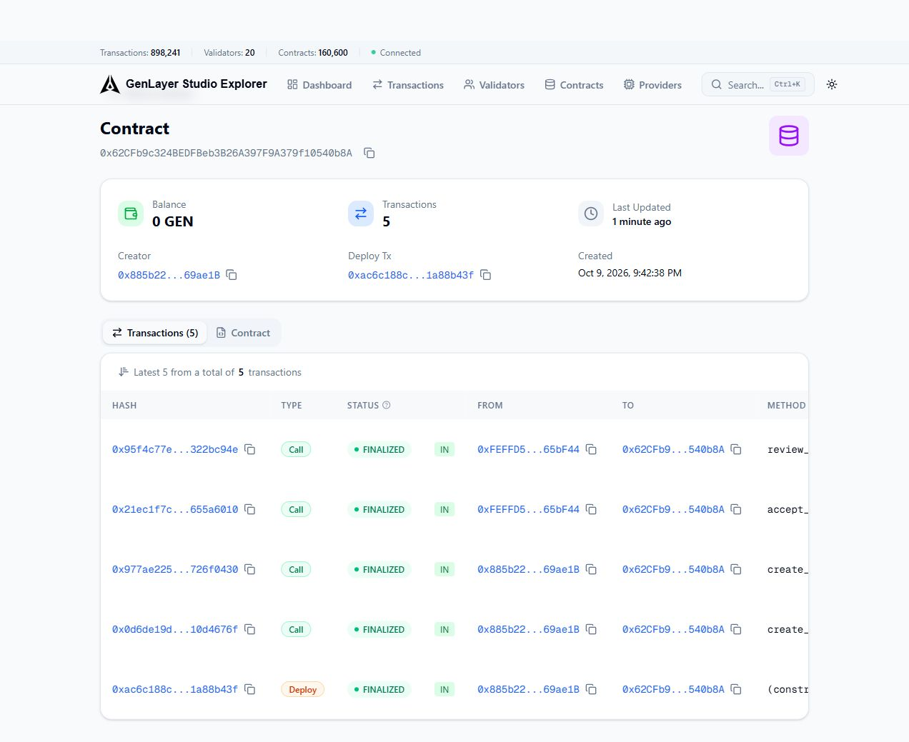
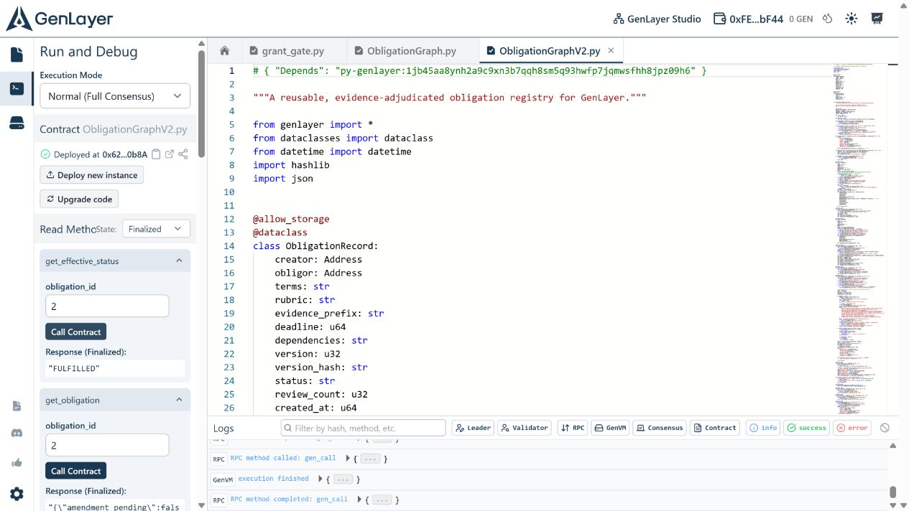

# ObligationGraph — submission brief

## Summary

ObligationGraph is a reusable GenLayer Intelligent Contract for two-party obligations. It makes written commitments queryable by other contracts, records agreed amendments as immutable SHA-256-linked versions, and uses validator consensus to classify public evidence against a rubric. Dependency edges form an acyclic obligation graph, so a downstream commitment can remain blocked until its prerequisites are fulfilled.

## Why the intelligent contract is necessary

Deterministic code can enforce who may create, accept, amend, and query an obligation. It cannot reliably decide whether a report, certificate, or other prose evidence satisfies written terms. `review_evidence` uses GenLayer's non-deterministic execution for that assessment. Every validator independently fetches the same URL, hashes its UTF-8 body, and produces one of five outcomes. A proposal passes only when the body hash and decision-bearing outcome agree.

## Distinctive capabilities

- Reusable registry API for consumer contracts: `get_obligation`, `get_effective_status`, `get_version`, and `get_review`.
- Mutually accepted amendments with permanent version snapshots and SHA-256 predecessor hashes.
- Acyclic dependencies enforced at creation; `BLOCKED` and `OVERDUE` are derived views, leaving adjudicated state intact.
- Bounded public evidence fetches, an agreed HTTPS source prefix, structured outcomes, and independent validator reassessment.
- `INSUFFICIENT` reviews are recorded without changing the lifecycle status.

## Verification ledger

| Check | Result |
| --- | --- |
| `pytest tests -q` | 7 passed, including five-validator GLSim consensus |
| `genvm-lint check contracts/ObligationGraph.py --json` | Passed: 11 public methods (5 views, 6 writes); informational newer-runner notice |
| Hosted Studio, Normal (Full Consensus) | Deployment finalized at [`0x62CFb9c324BEDFBeb3B26A397F9A379f10540b8A`](https://explorer-studio.genlayer.com/address/0x62CFb9c324BEDFBeb3B26A397F9A379f10540b8A) |
| Hosted Studio `create_obligation` | Transaction `0x0d6de19d9d66c4b75d4deae637e2b5c84c1fb396843391db3d0a775a10d4676f` finalized; GenVM returned successfully |
| Hosted Studio `get_obligation(1)` | Finalized-state read returned `DRAFT`, version 0, the agreed terms/rubric, and the expected parties |
| Hosted Studio two-party lifecycle | [`create_obligation(2)`](https://explorer-studio.genlayer.com/tx/0x977ae225dfa94c14c166f124c8bad5da5472c38ad77f2a43b05ceb6e726f0430), [`accept_obligation(2)`](https://explorer-studio.genlayer.com/tx/0x21ec1f7c835bc837504a522b05249a2a1930235836c723ec356efd52655a6010), and [`review_evidence(2)`](https://explorer-studio.genlayer.com/tx/0x95f4c77e42c140fd349d9c1f4f2bbd16e7cd1246bc60d7be8785ede2322bc94e) all finalized with GenVM `SUCCESS` in Normal (Full Consensus) |
| Hosted Studio finalized views | `get_effective_status(2)` returned `FULFILLED`; `get_review(2, 1)` recorded outcome `FULFILLED`, evidence hash `9db8336874ca896ae3e88efca8efaf6d058f32730ef0c9fc912de43ef27aed89`, and version hash `3955a3c0480c16d267a38ecf845b3cca86b9b2d5369e3388c4ea36dab2ddb690` |

The Studio source tab is named `ObligationGraphV2.py` because earlier compatibility probes occupied the original tab. The uploaded file was copied byte-for-byte from `contracts/ObligationGraph.py` after the address-normalization fix. The deployed source is publicly readable on the Explorer contract's **Contract → Code** tab. The second Studio account and the pinned upstream GenVM license are test fixtures. This demonstration checks classification and state transition; it does not prove that the obligor authored the license or published it originally.

## Submission target and remaining publication step

- The [GenLayer Portal Intelligent Contracts category](https://portal.genlayer.foundation/contribution-type/52/) asks for a standalone reusable primitive, real GenLayer consensus logic, clear state design, readable source, and enough documentation or tests for review. ObligationGraph meets these technical checks. The Portal form accepts a title, up to 1,000 characters of description, and evidence URLs. `PORTAL_SUBMISSION.md` contains prepared copy and links.
- The [public GitHub repository](https://github.com/smokexbadlines-dot/obligationgraph-genlayer) exposes the README, tests, setup script, and proof images. The Explorer independently exposes the deployed source and finalized transactions.
- On a clean test machine, run `python scripts/prepare_test_runner.py` before `pytest`; `genlayer-test` 0.29.x requests the wrong release-asset name. The script downloads the official runner bundle and verifies its digest.

Packaged and uploaded source SHA-256: `9e50a016738ea4ac909e8e8be484af07dd38d51916befd12ec746a8b9b561173`.

## Demo sequence

1. Alice calls `create_obligation` for Bob, specifying terms, a rubric, an HTTPS evidence prefix, deadline, and optional dependencies.
2. Bob calls `accept_obligation`. The contract seals version 1 and becomes `ACTIVE`.
3. Bob publishes UTF-8 evidence under the agreed prefix and calls `review_evidence`.
4. After consensus and finality, a consumer queries `get_effective_status` and `get_review` to act on the result.
5. Either party can propose replacement terms. The other party's acceptance seals the next version, linked to the previous hash.

## Scope and trust assumptions

This contract is a status registry. It does not transfer assets or create legal enforceability. Evidence must be publicly reachable and stable across validators. A consensus outcome is a protocol decision, not a guarantee that the underlying publisher told the truth. Consumer contracts should wait for transaction finality before using a reviewed status. The README describes the state model, API, test setup, and security considerations in detail.
